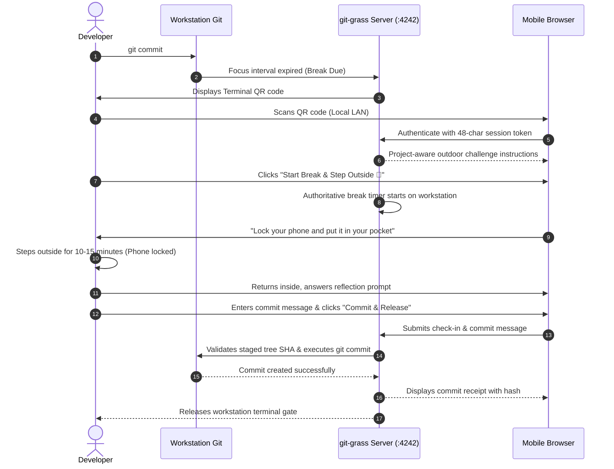
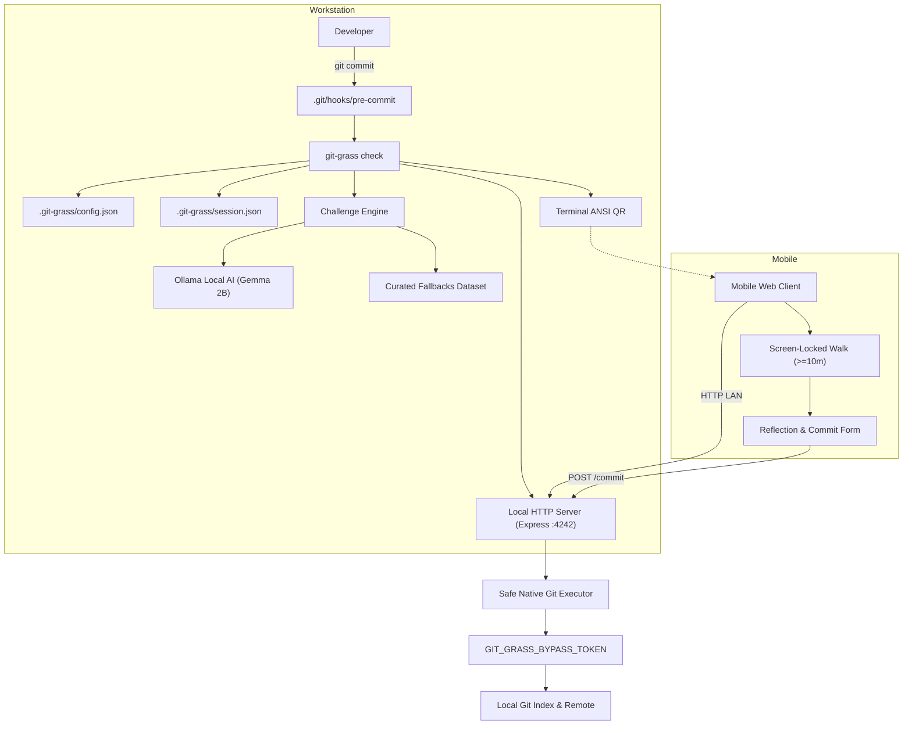

# 🌱 git-grass

> **"Your AI can write the code. It can't touch grass."**

[](https://opensource.org/licenses/MIT)
[](https://nodejs.org)
[](https://www.typescriptlang.org)
[](./tests)
[](./site/index.html)

**git-grass** is an open-source, Git-native outdoor-break enforcement tool that integrates physical recovery directly into your source control workflow. [Explore the documentation and interactive demo on the official website](./site/index.html).

When your configured focus interval expires, your next protected `git commit` is paused. The CLI generates a terminal QR code that opens an offline-resilient mobile web experience. Using repository metadata, git-grass generates an observational outdoor challenge tailored to your project domain using a **Render-hosted AI backend powered by Backboard**, Thinking Machines Tinker, local open-weight models (Ollama with Gemma 3), or zero-config bundled fallbacks.

The developer locks their phone, steps away from their workstation for at least 10 minutes, returns refreshed, completes a short check-in on the phone, and submits their commit message directly from their yard or doorway. The local CLI safely validates staging integrity and executes the commit.

---

## 📽️ Demo Video
> *Status: Pending recording. (See [Terminal Demo](#terminal-demo) and [Manual Testing Guide](./docs/TESTING.md) for live reproduction steps).*

---

## 🚨 Problem Statement

Modern AI-assisted development tools (Copilot, Cursor, Gemini, Claude) enable unprecedented coding velocity. However, this velocity creates uninterrupted marathons in front of monitors:
- **Dismissible Reminders:** Standard desktop notification alerts are reflexively clicked away in milliseconds.
- **Ocular and Cognitive Fatigue:** Long stretches without focal depth changes strain vision and degrade architectural thinking.
- **Screen-Based "Breaks":** Developers take breaks by browsing social media or reading feeds on their phones, offering zero cognitive or physical recovery.

---

## 🌿 The Solution: Git-Native Gating

git-grass establishes **Git** as the gatekeeper of developer wellness:
1. **Zero Distraction While Working:** git-grass does not pop up intrusive banners or disrupt your coding flow while you are in focus.
2. **Natural Milestone Enforcement:** The gate triggers only when you finish a block of work and execute `git commit`.
3. **Guaranteed Staged Integrity:** Staged changes are fingerprinted (`git write-tree`) and strictly preserved.
4. **Phone as a Temporary Bridge:** The phone interface is not a dashboard or feed; it explicitly instructs you to lock your screen and step outside.
5. **Domain-Aware Challenges:** Instead of generic push-ups, tasks are thematic observational walks (e.g. noticing civil routing systems when building backend infra, or observing light contrast when tuning UI designs).
6. **$0 Cost & 100% Local:** No cloud accounts, databases, API keys, or subscriptions required.

---

## 🖥️ Terminal Demo

When an outdoor break is due, running `git commit` yields:

```text
$ git commit -m "feat: complete search engine backend"

🌱 git-grass

Your AI can write the code.
It can't touch grass.

A break is required.

Minimum duration: 10 minutes
Your staged changes are preserved.

Scan the QR code to receive
your outdoor challenge:

  █████████████████████████████████
  █████████████████████████████████
  ████ ▄▄▄▄▄ █▀▄█▄ ▀█ █ ▄▄▄▄▄ █████
  ████ █   █ █ █ ▀█ ▄ █ █   █ █████
  ████ █▄▄▄█ █▀█▀ █▄▀ █ █▄▄▄█ █████
  ████▄▄▄▄▄▄▄█▄▀ ▀▄█▄▀█▄▄▄▄▄▄▄█████
  ████▄▄█ ▄ ▄█▄▀█ ▄█▄▄█▄▄ ▄ ▄▄█████
  ████ █▄▀ ▄▄  ▄█▀▄ ▀ ▀▀▄▄▀▄ ▄█████
  ████▄█▄▄█▄▄█▄▄▀ ▀▄  █▄▄▄█ █▄█████
  ████ ▄▄▄▄▄ █▄█ ▀ ▄ ▄█ ▄ █  ██████
  ████ █   █ █ █▄▄▄▀▀ █▄▄▄█▄ ▄█████
  ████ █▄▄▄█ █ ▄ ▀▀▀█ ▄ ▄ ▄  ██████
  ████▄▄▄▄▄▄▄█▄▄▄█▄▄▄██▄█▄█▄▄▄█████
  █████████████████████████████████
  █████████████████████████████████

Or open in your browser / phone:
http://192.168.1.142:4242/?session=grass-20261010-9b4f&token=8e2f...

Git commit paused. Workstation will resume after outdoor break check-in.
```

---

## 📱 Mobile Workflow & User Journey



---

## 🎯 Project-Aware Challenge Examples

git-grass inspects your repository context and selects an outdoor observation task:

| Domain | Challenge Title | Observational Mission | Reflection Prompt |
|---|---|---|---|
| **GameDev / 3D** | *Real-World Level Designer* | Spot 3 physical shapes, elevation shifts, or obstacles in your neighborhood. | *"Which physical obstacle could inspire the most engaging game mechanic?"* |
| **Audio / Media** | *Soundscape Explorer* | Walk without headphones; identify near, mid, and distant acoustic layers. | *"Which sound was most difficult to distinguish from the ambient noise floor?"* |
| **Machine Learning** | *Pattern & Texture Observer* | Observe natural fractal textures, leaf veins, and shadow gradients. | *"What distinctive feature made one natural texture immediately recognizable?"* |
| **Frontend / Web** | *Everyday Information Systems* | Examine public physical signage, noticeboards, and typography outdoors. | *"What design element made the most effective sign understandable at 10 paces?"* |
| **DevOps / Systems** | *Distributed Infrastructure Walk* | Observe utility lines, storm conduits, and redundant physical paths. | *"What physical routing junction reminded you of backend architecture?"* |
| **General / Unknown** | *Curiosity Walk* | Walk half your normal speed; observe 3 details you usually miss. | *"What unexpected detail did you notice that you normally overlook?"* |

---

## 🏗️ Architecture Overview



---

## ⚙️ Technology Stack

| Area | Technology | Rationale |
|---|---|---|
| **Runtime** | Node.js (>= 18.0.0) | Cross-platform standard for developer CLI tools. |
| **Language** | TypeScript (ES2022 / NodeNext) | Type safety, maintainability, and clean modularity. |
| **CLI Framework** | Commander.js | Standard, lightweight command dispatcher. |
| **Schema Validation** | Zod | Runtime validation of configuration, sessions, and AI payloads. |
| **Local Server** | Express | Lightweight, reliable HTTP server bound to local LAN interface. |
| **QR Generation** | `qrcode-terminal` & `qrcode` | Crisp ANSI QR codes displayed directly in terminal windows. |
| **Git Integration** | Native Git via `child_process.execFile` | Safe execution with argument arrays; zero shell interpolation. |
| **Mobile Client** | Vanilla HTML5, CSS3, JavaScript | Zero-dependency, lightweight, offline-resilient, instant mobile load. |
| **AI Inference** | Ollama (`gemma:2b` / `gemma2`) | Open-weight local LLM; 100% private, $0 cost, zero API keys. |
| **Fallback Library** | Curated JSON (`challenges/fallback-challenges.json`) | Immediate graceful failover when AI server is absent. |
| **Test Suite** | Vitest | High-speed ESM native testing across isolated disposable repos. |

---

## 🚀 Installation & Quick Start

### Global Installation

```bash
npm install -g git-grass
```

Or execute directly via `npx`:
```bash
npx git-grass --help
```

### Enable in a Git Repository

Navigate to any Git repository:
```bash
cd my-project
git grass init
```

`git grass init` will:
1. Detect repository root.
2. Initialize `.git-grass/config.json` with sensible defaults (60m interval, 15m duration).
3. Safely install or wrap the `.git/hooks/pre-commit` hook without clobbering existing hooks.

---

## 📖 CLI Command Reference

### `git grass init [options]`
Initialize git-grass in the current Git repository and install the commit gate.
- `-i, --interval <minutes>`: Set break interval in minutes (default: `60`, min: `10`).
- `-d, --duration <minutes>`: Set default break duration in minutes (default: `15`, min: `10`).
- `--auto-push`: Enable automatic push to upstream branch after verified commit.

### `git grass status`
Displays timer status, elapsed minutes since last break, active sessions, and configuration summary.

### `git grass check`
Used by Git hooks. Exits `0` if commit may proceed, or starts the session gate and exits non-zero if a break is required.

### `git grass start [options]`
Manually starts an outdoor break session immediately and displays the QR code.
- `-d, --duration <minutes>`: Duration in minutes (min: `10`).
- `-p, --port <port>`: Server port (default: `4242`).

### `git grass verify`
Checks whether the active session has satisfied server-side duration and check-in requirements.

### `git grass config [key] [value]`
Inspects or safely updates repository configuration values:
```bash
# View entire configuration
git grass config

# Update break interval
git grass config interval 45

# Update default walk duration
git grass config duration 20

# Enable auto-push
git grass config autoPush true

# Reset last break timer to now
git grass config resetLastBreak
```

### `git grass doctor`
Runs a comprehensive environment diagnostic check:
- Node.js & Git version check
- Active repository configuration
- Ollama CLI installation status
- Local Ollama API connectivity (`http://127.0.0.1:11434`)
- Target model (`gemma3:1b`) availability and live test inference
- Bundled offline fallback dataset availability

### `git grass challenge [--test]`
Generates and displays an outdoor observation challenge for the current repository without triggering a Git commit or starting a break session. Tests the challenge generation pipeline and schema validation directly.

### `git grass uninstall [--yes]`
Safely removes git-grass pre-commit hooks and `.git-grass/` configuration, strictly preserving any unrelated custom hooks.

---

## ☁️ Hosted AI Backend (Render + Backboard — ₹0 Laptop Setup)

For developers who want real AI-generated, project-aware challenges without installing Ollama, Gemma, Python, Docker, or native AI runtimes on their machine, git-grass provides a lightweight, dedicated cloud backend.

### Architecture Overview
- **Deployment Platform:** Render Web Service (Free Tier, 0.0.0.0 binding, zero persistent disk needed).
- **Inference Engine:** [Backboard API](https://app.backboard.io) (`POST /threads/messages`) using existing account credits with default provider `google` / model `gemini-2.0-flash` ($0.10/M tokens, near-zero cost).
- **Credit & Abuse Protection:**
  - **In-Memory Cache:** 1-hour TTL cache (up to 1,000 entries) preventing identical queries from consuming duplicate credits.
  - **Sliding-Window Rate Limiter:** 15 requests/minute per client IP to prevent runaway credit drainage.
- **Thinking Machines Tinker Status:** Evaluated as an optional research provider, but **disabled by default** to safeguard user credits because Tinker is a distributed LoRA sampling/training infrastructure rather than a turnkey REST API.
- **Local Privacy Unaltered:** The local session server remains completely private on your local LAN. The hosted API only processes repository metadata (project name, category, detected keywords) and returns the challenge text.

### Deploying to Render in 3 Steps ($0 Cost)

1. **Deploy with Blueprint:** Connect your git-grass repository fork to Render and select **New Web Service from Blueprint**, or deploy manually using the included `render.yaml`:
   - **Environment:** `Node`
   - **Build Command:** `npm install && npm run build`
   - **Start Command:** `npm run start:hosted`
   - **Instance Type:** `Free`

2. **Configure Environment Variables in Render Dashboard:**
   | Variable | Description | Recommended / Default |
   | :--- | :--- | :--- |
   | `AI_PROVIDER` | Active AI provider (`backboard`, `fallback`) | `backboard` |
   | `BACKBOARD_API_KEY` | Your Backboard API Key from [app.backboard.io](https://app.backboard.io) | *(Your Secret Key)* |
   | `BACKBOARD_PROVIDER` | LLM provider on Backboard | `google` |
   | `BACKBOARD_MODEL` | LLM model on Backboard | `gemini-2.0-flash` |
   | `RATE_LIMIT_MAX` | Max requests per minute per IP | `15` |
   | `CACHE_TTL_MS` | Cache TTL in milliseconds | `3600000` (1 hour) |

3. **Configure Your Local Git-Grass CLI:**
   Point your local CLI to your deployed Render URL:
   ```bash
   git grass config hostedBackendUrl https://your-service.onrender.com
   ```
   *Or set the environment variable:*
   ```bash
   export GIT_GRASS_BACKEND_URL=https://your-service.onrender.com
   ```

Verify connectivity anytime using:
```bash
git grass doctor
```

---

## 🧠 Local AI Setup (Ollama & Gemma 3 - Optional Alternative)

git-grass is designed to work **100% out-of-the-box with bundled domain fallbacks without any mandatory AI setup**.

If you wish to enable dynamic, project-aware outdoor challenge generation powered by local open-weight AI:

### 1. Install Ollama
- **Windows:** Download the official Windows installer from [ollama.com/download](https://ollama.com/download), or install via Windows Package Manager:
  ```powershell
  winget install Ollama.Ollama
  ```
- **macOS / Linux:** Follow instructions at [ollama.com](https://ollama.com).

### 2. Pull the Lightweight Gemma Model
We standardize on **`gemma3:1b`** as the default model. It is Google's compact, high-efficiency model optimized for low-resource environments:
- **Download Size:** ~1.0 GB
- **Required Disk Space:** ~1.5 GB
- **Active Memory (RAM):** ~2 GB
- **Cost:** $0, 100% local, no API keys or cloud accounts

To download:
```bash
ollama pull gemma3:1b
```

Verify your installed models:
```bash
ollama list
```

### 3. Verify AI Readiness
Run the built-in diagnostic doctor:
```bash
git grass doctor
```
If Ollama is running and `gemma3:1b` is installed, git-grass will report `Status: READY` and run a live test generation.

To preview a live challenge generation without making a commit:
```bash
git grass challenge --test
```

### 4. Offline Fallback Behavior
If Ollama is not installed, not running, times out (>6s), or if the model is missing, git-grass **instantly and transparently falls back to its bundled curated challenge library** (`challenges/fallback-challenges.json`). Your Git commit workflow is never interrupted by AI failures.

---

## 🔒 Security & Privacy Guarantees

- **No Source Code Transmitted:** git-grass never transmits source code files or Git history to external services.
- **Local Network Boundary:** The session server binds to your local Wi-Fi LAN address or loopback. No public internet tunnels are opened.
- **Cryptographic Tokens:** Sessions use 48-character hex tokens evaluated with constant-time equality checks.
- **Zero Shell Concatenation:** Git commands are executed with argument arrays via `execFile` to eliminate shell injection risks.
- **Integrity Fingerprints:** Staged changes are validated before commit execution using `git write-tree`.
- **Workflow Gate, Not a Prison:** Developers can bypass pre-commit hooks when emergencies arise with `git commit --no-verify`.

---

## 🧪 Testing

git-grass comes with a comprehensive test suite across unit, server, and Git integration boundaries:

```bash
# Run all tests
npm test

# Run tests in watch mode
npm run test:watch

# Verify TypeScript compilation
npm run lint
```

Integration tests dynamically spin up isolated disposable Git repositories in temporary OS directories to verify hook behavior, staged index integrity, and recursion prevention.

---

## 🛠️ Troubleshooting

### "The QR code points to 127.0.0.1 and my phone cannot connect"
If your computer is not connected to a local Wi-Fi network or hotspot, git-grass falls back to `127.0.0.1`. Connect both your computer and phone to the same local Wi-Fi network or mobile hotspot, and re-run `git grass start`.

### "My existing pre-commit hook disappeared"
git-grass never deletes existing pre-commit hooks. It prepends its wrapper block with distinct `# --- BEGIN GIT-GRASS HOOK ---` markers. When uninstalled with `git grass uninstall -y`, git-grass strips only its own block, leaving your original linter/formatter scripts intact.

---

## 📚 Complete Documentation Set

- [Official Website & Interactive Demo](./site/index.html)
- [Product Requirements Document (PRD)](./docs/PRD.md)
- [System Architecture & Sequence Diagrams](./docs/ARCHITECTURE.md)
- [Implementation Plan & Delivery Record](./docs/IMPLEMENTATION_PLAN.md)
- [Task Tracker](./docs/TASK.md)
- [Security Model & Threat Assessment](./docs/SECURITY.md)
- [Testing & Quality Assurance Guide](./docs/TESTING.md)
- [Contributing Guidelines](./docs/CONTRIBUTING.md)
- [Architectural Decision Records (ADRs)](./docs/DECISIONS.md)
- [Project Roadmap](./docs/ROADMAP.md)

---

## 🏆 Hackathon Context

**git-grass** was created during an intensive engineering sprint as an open-source contribution to developer wellness. It proves that developer tooling can balance shipping velocity with biological reality.

*Your AI can write the code. It can't touch grass.*

---

## 📄 License

MIT © [Sneha Tiwari](https://github.com/sn3hhaa) and git-grass contributors.
