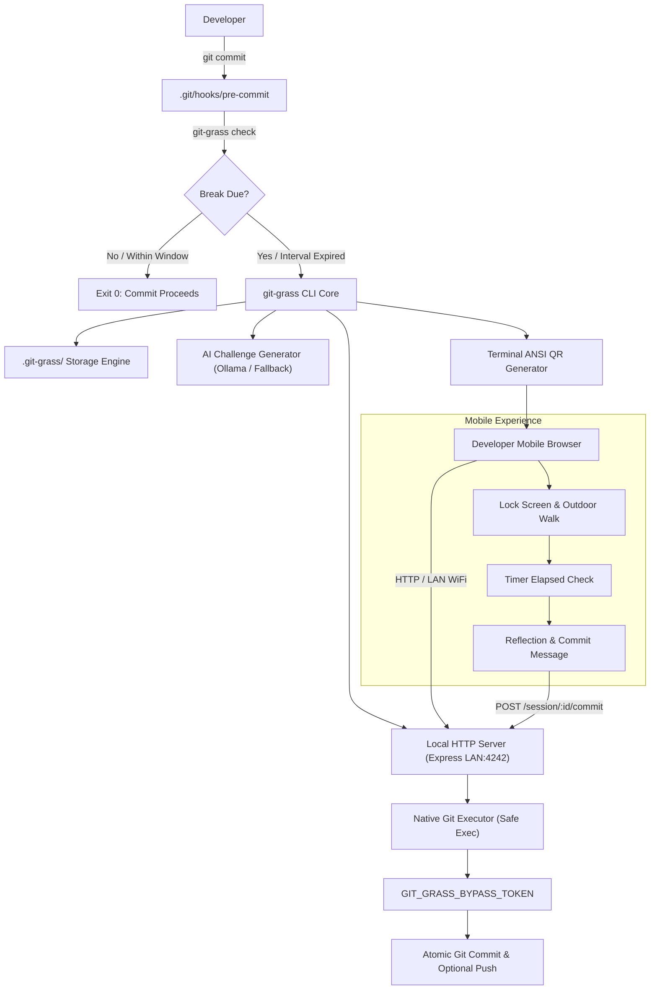
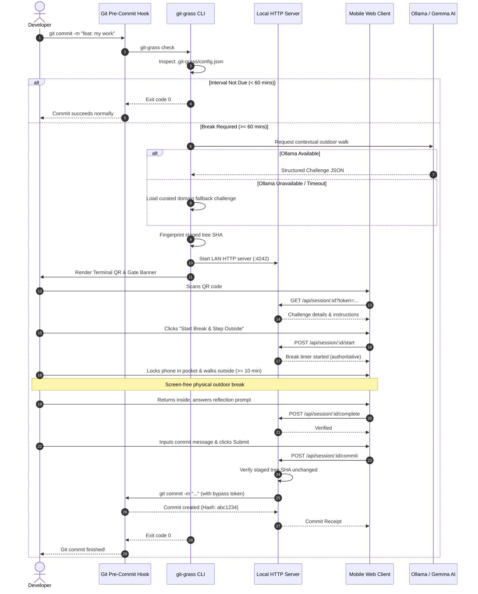
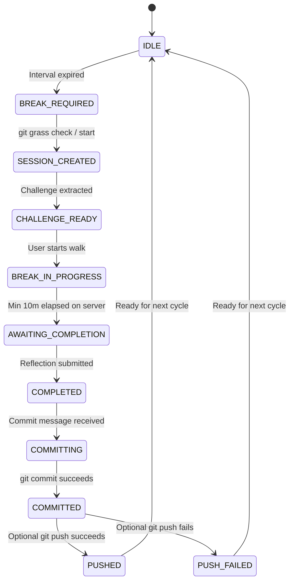

# System Architecture & Technical Design — git-grass

**git-grass** is an editor-independent developer utility composed of a TypeScript CLI, native Git hook wrapper, local HTTP server, mobile web application, and contextual challenge generator.

---

## 1. High-Level Architecture Diagram

---

## 2. Component & Module Responsibilities

| Module | Source Path | Primary Responsibility |
|---|---|---|
| **CLI Dispatcher** | `src/cli/index.ts` | Commander.js commands: `init`, `status`, `check`, `start`, `verify`, `config`, `uninstall`. |
| **Git Repository** | `src/git/repository.ts` | Discovers Git root, validates git availability, queries remotes/branches. |
| **Git Executor** | `src/git/executor.ts` | Executes git commands with argument arrays via `child_process.execFile` (zero shell interpolation). |
| **Hook Manager** | `src/git/hooks.ts` | Injects and uninstalls pre-commit wrapper while cleanly preserving existing hooks. |
| **Staged Integrity** | `src/git/staged-state.ts` | Fingerprints staged index tree SHA via `git write-tree` to guard against modifications. |
| **Commit Pipeline** | `src/git/commit-flow.ts` | Performs atomic commits and optional remote pushes with environment bypass markers. |
| **Session Manager** | `src/session/manager.ts` | Coordinates session lifecycles, timers, and challenge associations. |
| **Session Storage** | `src/session/storage.ts` | Atomic JSON read/write persistence for config and active session state. |
| **Validation Engine**| `src/session/validation.ts`| Enforces 10-minute minimums, constant-time token verification, and state transitions. |
| **Context Extractor**| `src/challenge/context.ts`| Summarizes repository name, README excerpt, and package keywords boundedly. |
| **AI Provider** | `src/challenge/ollama.ts` | Queries local Ollama endpoint (`gemma:2b` / `gemma2`) with strict timeouts. |
| **Fallback Engine** | `src/challenge/fallback.ts`| Loads and matches curated domain-aware challenges offline. |
| **Local Web App** | `src/server/` & `web/` | Express HTTP server and high-contrast, offline-resilient mobile web client. |

---

## 3. End-to-End Sequence Diagram

---

## 4. Session State Machine

---

## 5. Security & Boundary Architecture

1. **Local Network Boundary:** Server binds to local LAN interfaces or loopback. It never requires public tunneling services (e.g. ngrok) or internet proxies.
2. **Session Authentication:** Every request requires a cryptographically random token (`crypto.randomBytes(24)`). Constant-time comparison (`crypto.timingSafeEqual`) prevents timing attacks.
3. **Command Execution Safety:** All internal Git commands execute via `execFile` or `spawn` with explicitly isolated argument arrays. Shell concatenation is strictly prohibited.
4. **Staged Changes Immutability:** Staged files are fingerprinted via `git write-tree` when the break session begins. If an index change occurs while the developer is outside, the commit operation halts with an integrity error.
5. **No Source Exfiltration:** Only bounded metadata (repository name, short README sentence, dependency keyword list) is passed to the AI generator. Source code files are never uploaded or transmitted.

---

## 6. HTTP API Specification

| Endpoint | Method | Auth | Payload | Description |
|---|---|---|---|---|
| `/api/session/:id` | `GET` | Bearer Token / Query | None | Retrieves sanitized session details and challenge. |
| `/api/session/:id/status` | `GET` | Bearer Token / Query | None | Polls current session state, server time, and elapsed minutes. |
| `/api/session/:id/start` | `POST` | Bearer Token / Body | None | Marks authoritative break start timestamp. |
| `/api/session/:id/complete` | `POST` | Bearer Token / Body | `{ reflection: string }` | Validates server elapsed time (>= 10m) and records reflection. |
| `/api/session/:id/commit` | `POST` | Bearer Token / Body | `{ commitMessage: string }` | Verifies index integrity and executes local Git commit. |
| `/` or `/session/:id` | `GET` | None | None | Serves responsive mobile web application. |
